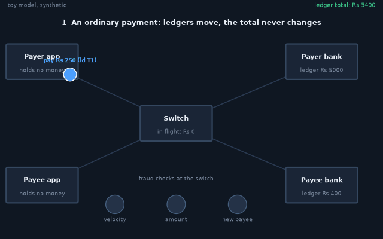
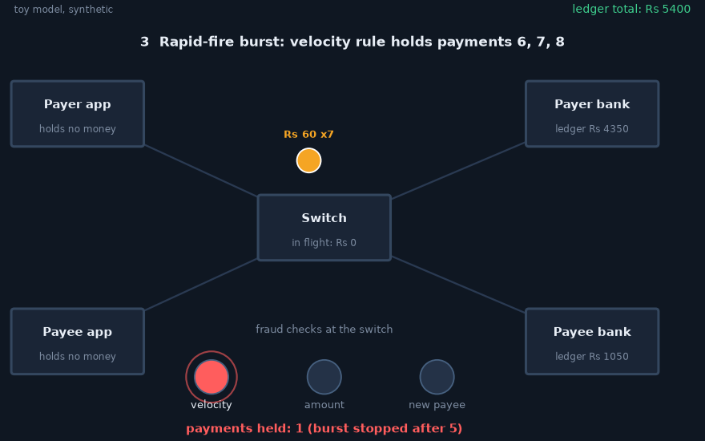
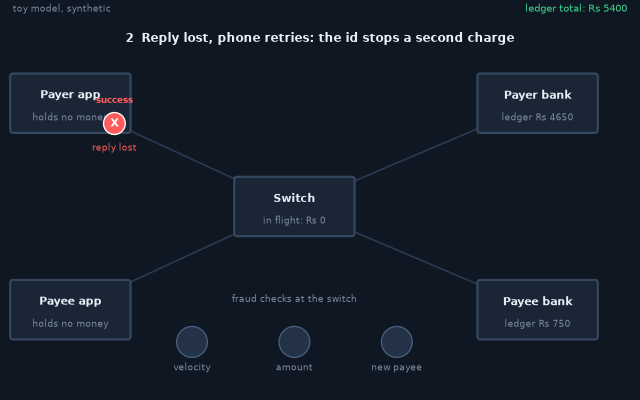
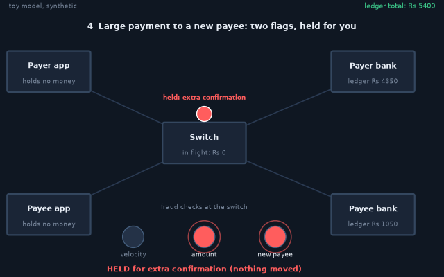
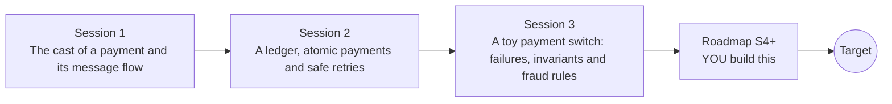

# openupi

[](https://github.com/KrunalPanchal1995/openupi/actions/workflows/ci.yml)   [](https://colab.research.google.com/github/KrunalPanchal1995/openupi/blob/main/sessions/session-01/lesson.ipynb) [](https://krunalpanchal1995.github.io/openupi/)

**Trace a digital payment from tap to bank balance, in three sessions.**

openupi teaches how a digital payment really works behind the screen: messages, ledgers, retries and fraud checks, using only Python and a browser.

- **Follow the money.** Session 1 shows that money moves as changes of numbers in ledgers, not as coins.
- **Break it, then fix it.** Session 3 injects lost replies and retries so you see exactly what goes wrong without an idempotency key.
- **Know you got it right.** Each session ends with a checkpoint that prints PASS or FAIL against hand calculations and invariants.
- **Defence, measured.** Fraud rules are judged by false positive and false negative rates on invented data, never by feelings.

[Target](#the-target) · [Who is this for](#who-is-this-for) · [Quick start](#quick-start) · [Sessions](#sessions) · [Roadmap](#roadmap) · [Contribute](#contribute) · [Explainer PDF](docs/explainer.pdf)

> **This repo is incomplete on purpose.** Sessions 1 to 3 are here and fully working. The finished Target below is a preview of what the community can build next. We show you the path, not the code. Sessions 4 and up are yours.

## The Target

An animated message flow: a payer app, a switch and two banks pass messages while the ledgers update and the total stays constant. Scene by scene it shows an ordinary payment, a lost reply that is retried with the same id (charged once, not twice), a rapid-fire burst whose sixth payment is held by the velocity rule, and a large payment to a new payee that lights two fraud flags. Your goal over the coming sessions: build the message flow, the ledgers and the fraud checks yourself, then grow them toward reconciliation and crash recovery.



*Target: message flow with ledgers updating and fraud flags lighting up*



*Target still: a rapid-fire burst held by the velocity rule*



*A lost reply: the phone retries with the same id*



*A large payment to a new payee is held: two flags lit*

Try it live:

- [Math Visual Studio: probability (Atlas S24)](https://krunalpanchal1995.github.io/studio/#atlas?ch=S24&ex=1)
- [Math Visual Studio: probability distributions (Atlas S25)](https://krunalpanchal1995.github.io/studio/#atlas?ch=S25&ex=1)

How the Target was made is shown only as a path in [promo/roadmap.md](promo/roadmap.md).

## Who is this for
**middle school to higher secondary (levels 2-4).** Topic area: Everyday Life and Practical Knowledge.

Prerequisites:

- Adding and subtracting whole numbers; reading a simple graph. A little probability (a chance between 0 and 1) helps in Session 3.
- Python 3.10 or newer; if `python --version` works, you are ready. PRIMER.md explains the rest.
- No prior GitHub, banking or security knowledge is needed.

New to Python? Read [PRIMER.md](PRIMER.md) first (10 minutes).

## Quick start

No installation knowledge needed. You need [Git](https://git-scm.com/downloads) and [Python 3.10+](https://www.python.org/downloads/) (Windows: tick "Add Python to PATH"). On Mac and Linux type `python3` wherever this page says `python`.

```bash
git clone https://github.com/KrunalPanchal1995/openupi.git
cd openupi
python start.py 1
```

`start.py` creates a private environment, installs what is needed and runs Session 1 with its checkpoint. Next: `python start.py 2`, `python start.py 3`, or `python start.py test` to check everything. Only a checkpoint: `python start.py check 1`.

Four lines show the central idea of Session 2: one payment is two entries that add up to zero (they work as they are): Save it as `try.py` and run it with `python start.py run try.py` (this uses the private environment, where NumPy is installed):

```python
from collections import Counter
entries = [("T1", "payer", -250), ("T1", "payee", 250)]   # one payment = two entries
balance = Counter()
for _, account, amount in entries: balance[account] += amount
print(dict(balance), sum(balance.values()))              # -> {'payer': -250, 'payee': 250} 0
```

Every session also opens in your browser with sliders (no install): [live apps](https://krunalpanchal1995.github.io/openupi/). Or use the Colab badge above for the notebook.

## Sessions

| # | Session | Model level | Time | Live app |
|---|---|---|---|---|
| 1 | [The cast of a payment and its message flow](sessions/session-01/README.md) | Level 1: conceptual interactive model | 60 min | [open](https://krunalpanchal1995.github.io/openupi/session-01/) |
| 2 | [A ledger, atomic payments and safe retries](sessions/session-02/README.md) | Level 2: mathematical engineering model | 75 min | [open](https://krunalpanchal1995.github.io/openupi/session-02/) |
| 3 | [A toy payment switch: failures, invariants and fraud rules](sessions/session-03/README.md) | Level 3: simulation and validation | 90 min | [open](https://krunalpanchal1995.github.io/openupi/session-03/) |

Each session follows the same six steps: A real-world problem, B concept and theory, C visual explanation, D interactive simulation, E worked example and experiment, F assessment and design challenge. Each ends with `checkpoint.py`, which prints `PASS` or `FAIL` against reference numbers. Session 3 also contains the real-world mini-project: **Add a daily limit and stop a rapid-fire burst**.

## Architecture



| Folder or file | What is inside |
|---|---|
| `sessions/` | three sessions: README (A-F), `lesson.py`, notebook, live app, exercises, activity sheet, checkpoint |
| `promo/` | the Target: media, live links, and the roadmap (path only) |
| `docs/` | `explainer.tex` and the built `explainer.pdf` |
| `tests/` | runs every lesson and checkpoint headless |
| `start.py` | one command to set up and run anything |
| `QUALITY.md`, `RUBRIC.md` | the quality checklist and the scoring rubric |
| `.github/` | CI, PDF build, Pages deploy, issue and PR templates |

## Roadmap

| Milestone | What you will build | Difficulty |
|---|---|---|
| Session 4: Reconcile three ledgers at the end of the day | A version of the switch with three separate ledgers (payer bank, switch, payee bank), bank timeouts injected, and a reconciliation step that repairs mismatches. | advanced |
| Session 5: Catch the slow attack | A better scoring function than the three fixed rules, judged on the same seeded synthetic data. | advanced |
| Session 6: Lockout that recovers | A lockout that expires after 30 simulated minutes and a counter that is kept per account and per day. | intermediate |
| Session 7: Survive a crash: a write-ahead log | A switch that appends each payment to a log file first and rebuilds all balances and its id memory by replaying it. | advanced |
| Session 8: Two payments at once | A threaded test harness and per-account locking in the switch. | advanced |

Full detail with a checkpoint per milestone: [promo/roadmap.md](promo/roadmap.md).

## Contribute
New to GitHub? Read [CONTRIBUTING.md](CONTRIBUTING.md); it starts from zero. Pick an issue labelled `good first issue`. Translations into Hindi, Telugu, Tamil and Malayalam are welcome.

<details>
<summary>Development</summary>

```bash
python start.py test        # runs every lesson and checkpoint
```
Lessons use `# %%` cell markers so they open as notebooks in VS Code. See [QUALITY.md](QUALITY.md) for the standard every session meets.
</details>

## License
MIT. See [LICENSE](LICENSE). Media in `promo/media` is (c) Krunal Panchal, CC BY 4.0.

## Acknowledgments
Part of the [PAN IIT OSS](https://hellofoss.tech-iitb.org/projects) open-source teaching collection, modelled on the structure of [openspline](https://github.com/openspline/openspline). Built on ideas from the Math Visual Studio at https://krunalpanchal1995.github.io/studio/.
