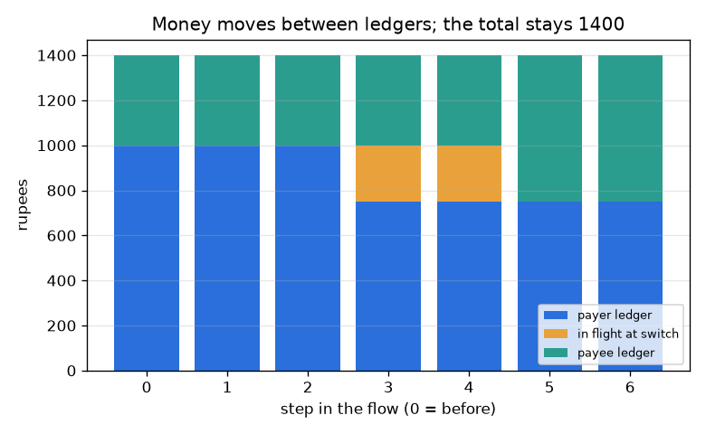
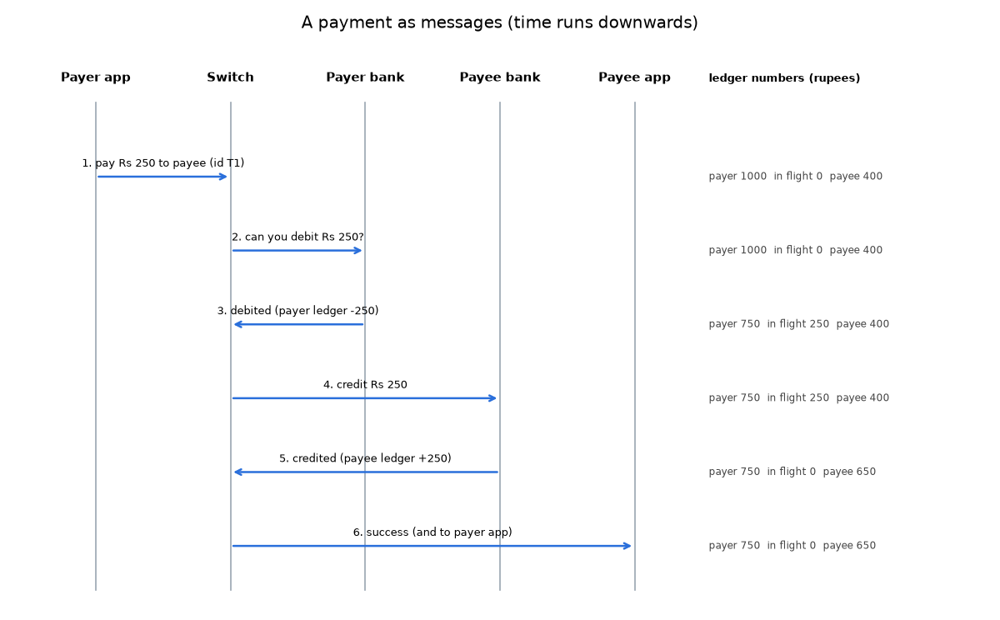

# Session 1: The cast of a payment and its message flow

*Level 1 (conceptual interactive model) · about 60 minutes · openupi*

> This is a simplified educational model. It is not a validated design tool and must not be used for real structures, electrical installations, vehicles, industrial processes or medical decisions.

**Prerequisites**

- Adding and subtracting whole numbers; reading a bar chart.
- You have read PRIMER.md and run `python start.py 1` once.

**Learning objectives.** After this session you can:

- Name the five actors in a digital payment and say what each one does and does not hold.
- Read a sequence diagram: time runs downwards and each arrow is one message.
- Explain that money moves as changes of numbers in ledgers, not as coins.
- Check that the total across all ledgers and the in-flight box never changes during a payment.

## A. Real-world problem
You scan a code at a shop, type your PIN, and a moment later both phones say success. Nothing physical moved. So what actually happened, who talked to whom, and where was your money while the screen was spinning? This session is general education about how such systems are organised, not advice about any real app, bank or account, and it uses a simplified picture.

## B. Concept and theory
A payment involves a cast. The payer app and payee app are only windows on phones: they send and show messages and hold no money. Each customer's money is a number in a ledger kept by that customer's bank. A switch in the middle passes messages between apps and banks and tracks the payment on its way. The payer app asks the switch to pay X rupees; the switch asks the payer bank to debit X; the payer bank lowers the payer's ledger number and says so; the switch asks the payee bank to credit X; the payee bank raises the payee's ledger number and says so; and the switch tells both apps. Between the debit and the credit the X rupees are in flight: we count them in a box at the switch so that every rupee always has exactly one home. If the payer's balance is smaller than X, the payer bank declines and nothing moves.

| Symbol | Meaning | Unit |
|---|---|---|
| X | payment amount | rupees |
| P | payer's ledger balance at the payer bank | rupees |
| Q | payee's ledger balance at the payee bank | rupees |
| F | money in flight at the switch | rupees |
| T | total of all three boxes | rupees |
| k | step in the message flow (0 to 6) | count |

**Assumptions**

- One payment at a time, no failures: every message arrives.
- The banks and the switch are honest and correct.
- Amounts are whole rupees and positive.
- This is a teaching picture, not the design of any real payment network.

$$ P' = P - X,\qquad Q' = Q + X\qquad (X \le P) $$

$$ T = P + F + Q $$

$$ T_{\text{after}} = T_{\text{before}}\quad\text{(no money is created or lost)} $$

## C. Visual explanation
The first figure is a sequence diagram: five vertical lines for the actors, time running downwards, and one arrow per message, with the three ledger numbers printed beside each arrow. The second figure stacks the three boxes (payer ledger, in flight, payee ledger) at each of the seven steps. The stack height stays at 1400 all the way down, while the colours move: blue shrinks at step 3, an orange in-flight block appears at steps 3 and 4, and green grows at step 5.

*Payer ledger, in-flight money and payee ledger at each step: the total stays 1400 rupees.*

*A payment as six messages; the three ledger numbers are printed beside each arrow.*

## D. Interactive simulation
Run the lesson (`python start.py 1`), then open the live app: [Session 1: follow a payment](https://krunalpanchal1995.github.io/openupi/session-01/) (or `app.html` in this folder). Slide the step control from 0 to 6 and watch the ledger boxes change only at steps 3 and 5; then change the amount and open the graph view to see the final balances against the amount.

**Challenge.** Make the payee end with exactly Rs 900 after the last message.

## E. Worked example and experiment
**Problem.** The payer has Rs 1000 and the payee has Rs 400. The payer pays Rs 250. Find the three numbers after each step and check the total.

1. Before step 3 nothing has moved: payer 1000, in flight 0, payee 400, total 1400.
2. Step 3 (payer bank debits): payer = 1000 - 250 = 750 and in flight = 250. Total = 750 + 250 + 400 = 1400.
3. Step 4 (switch asks payee bank): nothing changes yet.
4. Step 5 (payee bank credits): in flight = 0 and payee = 400 + 250 = 650. Total = 750 + 0 + 650 = 1400.
5. Sanity check: the payer lost 250 and the payee gained 250, so the total did not change.

**Answer.** After the last message the payer has Rs 750, the payee Rs 650, nothing is in flight, and the total is still Rs 1400.

**Experiment.** Play the cast with friends and paper. One person is each bank and keeps a ledger on paper; one is the switch and holds slips marked in flight; two are apps and may only carry messages. Run the Rs 250 payment, then run one where the payer has too little. Compare the paper ledgers with the app readout. Model versus reality: the paper version has no lost messages and no cheating, and real banks also keep logs, fees, limits and legal records that this picture leaves out.

## F. Assessment and design challenge
**Question type A: Conceptual.** Why do the payer app and the payee app hold no money, and why do we need the in-flight box at the switch?

Hint

Where do the ledger numbers live, and where is the money between steps 3 and 5?

Step-by-step solution

The apps are only windows that send and show messages. The ledger numbers live at the banks. Between the debit (step 3) and the credit (step 5) the payer's ledger is already lower but the payee's is not yet higher. Counting the money in an in-flight box gives every rupee exactly one home at every moment, so the total stays the same and we can check it.

**Question type B: Numerical.** The payer has Rs 2000 and the payee has Rs 150. The payer pays Rs 600. Give the three numbers after step 3 and after step 6, and the total each time.

Hint

Step 3 moves the amount into flight; step 5 moves it into the payee ledger.

Step-by-step solution

After step 3: payer 2000 - 600 = 1400, in flight 600, payee 150, total 2150. After step 6: payer 1400, in flight 0, payee 150 + 600 = 750, total 1400 + 0 + 750 = 2150. Units: rupees. The total is the same, as it must be.

**Question type C: Graph and simulation interpretation.** In the stacked-bar figure, at which steps is there an orange in-flight block, and what happens to the total height?

Hint

Find the steps where the debit has happened but the credit has not.

Step-by-step solution

The orange block exists after steps 3 and 4 only: the debit has happened, the credit has not. The total height is 1400 rupees at every step, because the blue block loses exactly what the orange block gains, and the orange block loses exactly what the green block gains.

**Question type D: Design and optimisation challenge.** Design: the switch crashes after step 3 and never sends step 4. The payer has lost Rs 250 and the payee has gained nothing. Describe two sensible ways the system could recover, and what each would have to remember.

Hint

Either finish the payment or undo it. What record would let you decide?

Step-by-step solution

Option 1, complete: the switch (or a restart procedure) re-sends the credit to the payee bank using the same transaction id, so a repeated credit cannot be applied twice. Option 2, reverse: the payer bank credits Rs 250 back to the payer and records the payment as failed. Either way the system must durably remember the transaction id, the amount, both accounts and how far it got. Trade-off: completing is better for the shop but needs the payee bank to be reachable; reversing is simple but the customer must try again. Session 2 shows how a ledger makes this all-or-nothing.

Score yourself with [RUBRIC.md](../../RUBRIC.md). Print the [activity sheet](activity_sheet.md) to work on paper.

## Common misconceptions
| Common misconception | What is actually true |
|---|---|
| The money travels from my phone to the shop's phone. | Phones hold no money. Two ledger numbers at banks change; the message flow tells the banks when to change them. |
| The payment is finished the moment my screen says success. | The screen shows a message. The payment is only real once both ledgers have been updated. |
| The switch holds everyone's money. | In this picture the switch only holds a payment's amount briefly, as in flight. The banks keep the ledgers. |

## Glossary
- **ledger**: a list of accounts and the number of rupees each is owed by the bank
- **switch**: the shared middle box that passes messages between apps and banks
- **sequence diagram**: a picture with one vertical line per actor and one arrow per message, time going down
- **in flight**: money that has left one ledger but not yet reached the other
- **debit / credit**: taking money out of / putting money into a customer's account

## Finish
1. Do the three coding tasks in [exercises.md](exercises.md).
2. Run `python start.py 1` again after your changes. It ends with the checkpoint; when it prints `PASS`, you are done. (Checkpoint only: `python start.py check 1`.)

Next: [Session 2](../session-02/README.md)
