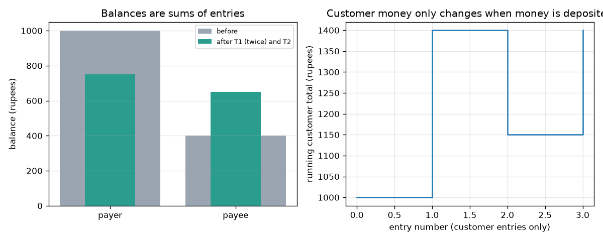
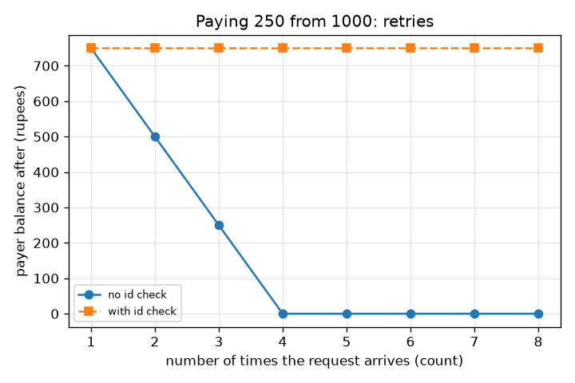

# Session 2: A ledger, atomic payments and safe retries

*Level 2 (mathematical engineering model) · about 75 minutes · openupi*

> This is a simplified educational model. It is not a validated design tool and must not be used for real structures, electrical installations, vehicles, industrial processes or medical decisions.

**Prerequisites**

- Session 1: ledgers and the message flow.
- Python lists and tuples; the idea of a sum.

**Learning objectives.** After this session you can:

- Write a payment as a double entry: two signed entries that add up to zero.
- Compute any balance as the sum of that account's entries and check that the whole ledger sums to zero.
- Explain atomic (all-or-nothing) transactions and show what a crash does without them.
- Use a unique transaction id to make a retry idempotent and count charges with and without it.
- Order the checks before a debit and justify the order.

## A. Real-world problem
You tap pay, the screen freezes, so you tap again. Did the shop get paid once or twice? A bank must get this right millions of times a day, even when its software crashes in the middle of a payment. The tools are old and simple: a double-entry ledger, atomic transactions and idempotency. This is general education about how such systems are built, not advice about any real account.

## B. Concept and theory
An entry is (transaction id, account, signed amount): money leaving an account is negative, money arriving is positive. A payment writes two entries with the same transaction id, so its entries sum to zero. We never store a balance on its own: the balance of an account is the sum of its entries. A special account MINT is where money enters the toy world, so even a deposit has two sides, and then the whole ledger always sums to zero and customer money equals money deposited. A transaction is atomic if either both entries are written or neither is; we get that by preparing both entries first and writing them in one step. A request is idempotent if doing it again changes nothing: the ledger remembers the first reply for each transaction id and returns it for any repeat. The order of checks matters: authenticate first, look for a duplicate id before checking the balance (a successful payment lowers the balance, so a retry would otherwise be wrongly declined), then validate the amount and limit, then the accounts, then the balance. Without an id check, n arrivals of a request for X from a balance B0 give min(n, floor(B0 / X)) charges; with it, exactly one charge if 0 < X <= B0, otherwise none.

| Symbol | Meaning | Unit |
|---|---|---|
| entry | (transaction id, account, signed amount) | id, name, rupees |
| B(a) | balance of account a | rupees |
| X | payment amount | rupees |
| B0 | payer's starting balance (1000) | rupees |
| n | how many times the same request arrives | count |
| c | number of times the payer is charged | count |

**Assumptions**

- One ledger in one process (a real bank has many).
- Amounts are positive whole rupees.
- Authentication is just True or False here; Session 3 checks a real PIN hash.
- Teaching model only; real banks add many more rules, audits and legal duties.

$$ B(a)=\sum_{e\,:\,\text{account}(e)=a}\text{amount}(e) $$

$$ \sum_{\text{all entries}}\text{amount}(e)=0\quad\Longrightarrow\quad \sum_{a\neq \text{MINT}}B(a)=\text{money deposited} $$

$$ c_{\text{no id check}}=\min\!\left(n,\left\lfloor \frac{B_0}{X}\right\rfloor\right),\qquad c_{\text{id check}}=1\ \ (0<X\le B_0) $$

$$ B_{\text{payer, after}}=B_0-X\,c $$

## C. Visual explanation
The first figure shows balances as bars (grey before, green after) for the payer and the payee, and a step line of the running customer total: it only changes when money is deposited, never when a payment is made. The second figure plots the payer's balance after the request arrives 1 to 8 times for a Rs 250 payment from Rs 1000. Without an id check the balance falls 750, 500, 250, 0 and then stays at 0 because the balance runs out; with the id check it stays at 750.

*Balances before and after, and the running customer total that only changes at deposits.*

*Payer balance after 1 to 8 arrivals of a Rs 250 request, with and without the id check.*

## D. Interactive simulation
Run the lesson (`python start.py 2`), then open the live app: [Session 2: retries and the id check](https://krunalpanchal1995.github.io/openupi/session-02/) (or `app.html` in this folder). Change the amount and the number of arrivals with the id check on and off, and watch the payer and payee bars and the red and green curves.

**Challenge.** Find a setting with the id check OFF where the payer is charged more than Rs 500 in total.

## E. Worked example and experiment
**Problem.** Start with payer 1000 and payee 400. Process (T1: pay 250), then (T1 again), then (T2: pay 900). Give the final balances and say what each reply is.

1. T1 is new, authenticated, 250 is within the limit and 1000 >= 250, so it is committed: payer 750, payee 650. Reply: ok.
2. T1 again is a duplicate id, so the saved reply (ok) is returned and nothing is written. The balances stay 750 and 650.
3. T2 asks for 900 but the payer has only 750, so it is declined: insufficient balance. Nothing moves.
4. Check: the entries are two deposits and one payment; every transaction sums to 0, the ledger sums to 0, and payer + payee = 750 + 650 = 1400 = 1000 + 400.

**Answer.** Payer Rs 750, payee Rs 650, customer total Rs 1400; the replies are ok, ok (replayed) and declined (insufficient balance).

**Experiment.** Keep a two-column paper ledger with a friend. Ask the friend to hand you the same payment slip twice, and see whether you notice by looking at the slip number. Then add an interruption: stop halfway through writing the second line and see what the book looks like. Model versus reality: a paper ledger relies on you noticing; a computer needs the id memory and the all-or-nothing write built in, and real ids must also survive restarts, which this in-memory model does not.

## F. Assessment and design challenge
**Question type A: Conceptual.** Why is it a problem if a program writes the debit, then crashes before writing the credit? What does writing both entries in one step change?

Hint

Add up all the entries after the crash.

Step-by-step solution

After the crash the ledger holds a debit with no matching credit: the entries no longer sum to zero and customer money has dropped by the amount (in the lesson, 250 rupees vanish). If both entries are prepared first and written in one step, a crash before the write leaves the ledger as it was and a crash after leaves a complete payment. Either way the ledger still sums to zero.

**Question type B: Numerical.** The payer has Rs 1000. A request for Rs 300 arrives 5 times. How much is the payer charged in total, and what are both balances, (a) without an id check and (b) with one? The payee starts with Rs 400.

Hint

Without the check, c = min(n, floor(B0 / X)).

Step-by-step solution

(a) floor(1000 / 300) = 3, so c = min(5, 3) = 3 charges: 900 rupees. Payer 1000 - 900 = 100, payee 400 + 900 = 1300, total 1400. (b) One charge: payer 700, payee 700, total 1400. Sanity check: the totals agree, and the balance never went negative because the 4th charge would have needed 1200 > 1000.

**Question type C: Graph and simulation interpretation.** In the retries figure (Rs 250 from Rs 1000), what are the payer balances without the id check for 1, 2, 3, 4 and 8 arrivals, and why does the red curve go flat?

Hint

Charges are min(n, 4) because floor(1000 / 250) = 4.

Step-by-step solution

1 arrival: 750; 2: 500; 3: 250; 4: 0; 8: 0. The curve goes flat at 0 because the balance check stops further debits once the money is gone. The flat part is not a safe outcome: the payer has paid four times for one purchase. The green curve stays at 750.

**Question type D: Design and optimisation challenge.** Design: list the checks a bank should run before debiting in a good order, and for each say what goes wrong if it is moved. Assume a per-payment limit of Rs 2000.

Hint

Think about strangers, retries of a payment that already happened, and nonsense amounts.

Step-by-step solution

Order: 1 authenticate (otherwise strangers learn about accounts and can probe them); 2 duplicate id (before the balance check, or a retry of a successful 900 payment from 1000 is wrongly declined for 'insufficient balance' because the balance is now 100); 3 amount valid and within the Rs 2000 limit (cheap, blocks nonsense such as 0, negative or fractional amounts); 4 payer is not the payee; 5 sufficient balance. Then commit both entries atomically. Trade-off: every extra check costs time and may block honest users, so limits should be set with real usage in mind. Assumption: one ledger, one request at a time.

Score yourself with [RUBRIC.md](../../RUBRIC.md). Print the [activity sheet](activity_sheet.md) to work on paper.

## Common misconceptions
| Common misconception | What is actually true |
|---|---|
| A balance is a number stored on the account. | In a ledger the balance is the sum of the account's entries; stored balances are only a speed-up that must always agree with the sum. |
| If the second line of a payment fails, the first line is harmless. | Then money has vanished from the ledger. That is why both lines must be written together or not at all. |
| Retrying is always safe. | A retry is only safe if the receiver treats the same transaction id as the same request. Without that, each retry is a new payment. |
| The balance check should come first because it is the most important. | A retry of a payment that already succeeded would fail the balance check and look like a failure. The duplicate check comes before it. |

## Glossary
- **double entry**: writing every payment twice, once as money out and once as money in, so entries sum to zero
- **atomic**: all-or-nothing: either every part of a transaction is written or none is
- **idempotent**: doing the request again has no further effect
- **transaction id**: a unique label sent with each request so repeats can be recognised
- **invariant**: a statement that must stay true after every operation

## Finish
1. Do the three coding tasks in [exercises.md](exercises.md).
2. Run `python start.py 2` again after your changes. It ends with the checkpoint; when it prints `PASS`, you are done. (Checkpoint only: `python start.py check 2`.)

Next: [Session 3](../session-03/README.md)
