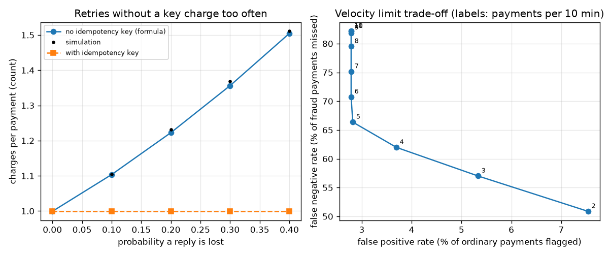
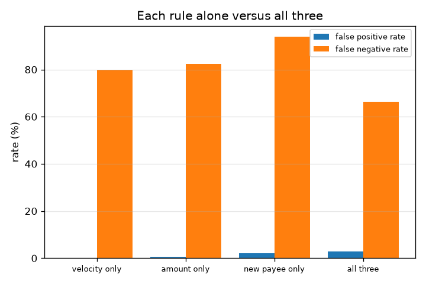

# Session 3: A toy payment switch: failures, invariants and fraud rules

*Level 3 (simulation and validation) · about 90 minutes · openupi*

> This is a simplified educational model. It is not a validated design tool and must not be used for real structures, electrical installations, vehicles, industrial processes or medical decisions.

**Prerequisites**

- Session 1: the message flow.
- Session 2: ledgers, atomic commits and idempotency.
- A little probability: a chance between 0 and 1; two independent chances multiply.

**Learning objectives.** After this session you can:

- Store a PIN safely as a salted hash and compare it in constant time, and explain why.
- Inject lost requests, lost replies and retries into a switch and check three invariants: money conserved, no negative balance, no double charge.
- Validate a formula for the expected number of charges against a simulation, and show the failure case without idempotency keys.
- Measure false positive and false negative rates of three fraud rules on seeded synthetic data and read the trade-off.
- Design a limit that caps the damage when fraud rules miss.

## A. Real-world problem
Real payment systems must stay correct when messages are lost, when people tap twice, and when someone who is not the owner tries to pay. Today you build a toy in-memory payment switch with accounts, a transaction log, a safely stored PIN, an idempotency key and simple fraud rules, stress it with invented trouble, and check that nobody is charged twice. It is a toy that borrows only the ideas: there is no networking, no real bank, no real UPI protocol and no real data. The fraud part is about defence: where checks sit and how well they work. General education only, not advice about any real account.

## B. Concept and theory
PIN safety: never store a PIN. Store hash_pin(PIN, salt), where the salt is random and different for each account and the hash (PBKDF2 with SHA-256, many repetitions) is slow to compute on purpose. To check an attempt, hash it with the stored salt and compare using a constant-time comparison (hmac.compare_digest), which does not reveal through timing where the first difference is. A 4-digit PIN has only 10000 values, so hashing alone cannot protect a stolen hash from being guessed; real systems also lock after a few wrong attempts (we lock after 3) and keep checks in secured hardware. Failure injection: each attempt is lost before reaching the switch with probability p_req, or processed with its reply lost with probability p_rep. The phone retries with the same transaction id up to k times. With a = 1 - p_req and s = a(1 - p_rep), the expected number of charges per payment without an id check is a(1 - (1 - s)^k) / s, and with an id check it is 1 - p_req^k (charged once if it ever arrives). Invariants: (1) all entries sum to zero and customer balances sum to the money put in; (2) no balance is negative; (3) each transaction id has at most one debit. A double charge keeps (1) and (2) true, which is why (3) is separate. Fraud rules run before the commit: velocity (more than V completed payments in 10 minutes), unusual amount (more than M times the account's median past amount, once there is history) and new payee (a payee not paid before, with amount at least 1000). A flagged payment is held until the owner confirms. The false positive rate is the share of ordinary payments flagged; the false negative rate is the share of fraud payments not flagged.

| Symbol | Meaning | Unit |
|---|---|---|
| p_req | chance an attempt is lost before the switch | probability (0 to 1) |
| p_rep | chance a processed attempt's reply is lost | probability (0 to 1) |
| k | maximum attempts by the phone | count |
| a, s | a = 1 - p_req; s = a(1 - p_rep) | probability |
| E | expected charges per payment | count |
| V, M | velocity limit (payments per 10 minutes) and amount multiple | count, no unit |
| FPR, FNR | false positive rate, false negative rate | fraction or percent |

**Assumptions**

- Everything is in one process; messages are lost by a random number generator, not by a network.
- The fraud data is synthetic: ordinary customers plus labelled invented attack patterns (burst, one large payment, slow and small). Real fraud is rarer and changes over time.
- A held payment of an ordinary customer is confirmed by that customer; a fraud payment is never confirmed.
- Amounts are whole rupees; PIN hashing uses fewer repetitions than a real system so that the lesson runs in seconds.
- This is a toy, not a design for real money, real PINs or real banks.

$$ E[\text{charges, no key}]=\frac{a\,\bigl(1-(1-s)^{k}\bigr)}{s},\qquad a=1-p_{\text{req}},\ \ s=a\,(1-p_{\text{rep}}) $$

$$ E[\text{charges, with key}]=1-p_{\text{req}}^{\,k} $$

$$ \mathrm{FPR}=\frac{FP}{FP+TN},\qquad \mathrm{FNR}=\frac{FN}{FN+TP} $$

$$ \text{invariants:}\ \ \sum_{e}\text{amount}(e)=0,\quad B(a)\ge 0,\quad \#\{\text{debits of one id}\}\le 1 $$

## C. Visual explanation
The left panel of the first figure plots the expected number of charges per payment against the chance a reply is lost, for p_req = 0.1 and 3 tries. The blue formula curve rises from 1.0 to about 1.5; the black simulation dots sit on it; and the orange dashed line with an idempotency key stays just below 1.0. The right panel plots the false negative rate against the false positive rate as the velocity limit V goes from 2 to 11: a strict limit (V = 2) misses fewer fraud payments (50.9 percent) but flags more ordinary payments (7.5 percent); a loose limit flags about 2.8 percent and misses 82 percent. The second figure compares each rule alone with all three together.

*Left: expected charges per payment against reply loss (formula, simulation, with key). Right: velocity-limit trade-off between false positives and false negatives.*

*False positive and false negative rates for each fraud rule alone and for all three together.*

## D. Interactive simulation
Run the lesson (`python start.py 3`), then open the live app: [Session 3: retries without a key](https://krunalpanchal1995.github.io/openupi/session-03/) (or `app.html` in this folder). Change the request-loss and reply-loss chances and the number of tries and watch the expected charges with and without a key; open the bar view to see the extra charges per 100 payments.

**Challenge.** Find a network where, without a key, there are at least 20 extra (duplicate) charges per 100 payments.

## E. Worked example and experiment
**Problem.** A test set has 1000 ordinary payments and 50 fraud payments. The rules flag 30 ordinary payments and 40 fraud payments. Find the false positive rate and the false negative rate and say what each means.

1. Ordinary payments: flagged = 30 (false positives, FP = 30), not flagged = 970 (true negatives, TN = 970).
2. FPR = FP / (FP + TN) = 30 / 1000 = 0.03, that is 3 percent of ordinary payments were wrongly flagged.
3. Fraud payments: flagged = 40 (true positives, TP = 40), not flagged = 10 (false negatives, FN = 10).
4. FNR = FN / (FN + TP) = 10 / 50 = 0.20, that is 20 percent of fraud payments were missed.
5. Sanity check: 30 + 970 = 1000 and 40 + 10 = 50, so every payment is counted once. On the lesson's seeded data the default rules give FPR 2.818 percent and FNR 66.374 percent, much worse on misses because slow, small attacks hide among ordinary payments.

**Answer.** FPR = 3 percent and FNR = 20 percent. Annoyed customers: 3 in 100 ordinary payments; missed fraud: 1 in 5 fraud payments.

**Experiment.** Take a week of invented payments (write 20 ordinary ones and 5 suspicious ones on cards), apply the three rules by hand with your own limits, and count FP, FN, TP and TN. Then change a limit and recount. Model versus reality: the lesson's data has 3.6 percent fraud (342 of 9496 payments), far more than a real system sees, so real false positives would swamp real fraud much more; real attackers also adapt to known rules, and real customers behave far more variously than the invented ones.

## Real-world application and mini-project: Add a daily limit and stop a rapid-fire burst
Fraud rules can miss things, so a bank also caps the damage. In Session 3 the toy `Switch` has no daily limit: `rapid_fire_test` sends 40 payments of Rs 900 and all 40 succeed, so Rs 36000 leaves one account. Add a `daily_limit` option to `Switch` (a day is 1440 simulated minutes, counted from `now`), refuse a payment that would take the day's total above the limit, and record the reason `daily limit` in the log. Use a limit of Rs 5000.

**Deliverable:** A script that builds a `Switch` with `daily_limit=5000`, runs `rapid_fire_test` on an account with Rs 50000, prints how many payments succeeded and how much money left the account, shows that three ordinary payments of Rs 300 on a different day still pass, and finishes by printing `check_invariants` for the switch.

**Success looks like:** At most 5 payments succeed and at most Rs 4500 leaves the account (5 x 900; the sixth would make 5400), the ordinary payments still pass, and all four invariants are True.

## F. Assessment and design challenge
**Question type A: Conceptual.** Why do we store a salted hash of a PIN instead of the PIN, and why compare with compare_digest instead of ==? Why is hashing still not enough for a 4-digit PIN?

Hint

Think about a stolen database, two people with the same PIN, and how many 4-digit PINs exist.

Step-by-step solution

If the database is stolen, plain PINs are immediately usable; hashes must be guessed. The salt makes the same PIN give different hashes, so one precomputed table does not work for all accounts. compare_digest takes the same time wherever the bytes differ, so timing does not leak how many leading bytes were right. There are only 10000 four-digit PINs, so if a hash and salt leak, all can be tried quickly; real systems add lockout after a few wrong attempts and keep PIN checks in secured hardware.

**Question type B: Numerical.** With p_req = 0.1, p_rep = 0.2 and k = 3, compute a, s, the expected charges per payment without a key and with a key, and the expected extra charges per 100 payments.

Hint

a = 0.9, s = 0.9 x 0.8. Use E = a(1 - (1 - s)^k)/s and 1 - p_req^k.

Step-by-step solution

a = 0.9 and s = 0.72. (1 - s)^3 = 0.28^3 = 0.021952, so E = 0.9 x (1 - 0.021952) / 0.72 = 0.9 x 0.978048 / 0.72 = 1.2226. With a key: 1 - 0.1^3 = 0.999. Extra = 1.2226 - 0.999 = 0.2236 per payment, about 22.4 per 100 payments. This matches the simulated value 1.2233 in the lesson. Units: charges per payment (a count).

**Question type C: Graph and simulation interpretation.** In the right-hand panel of the first figure, what happens to FPR and FNR when the velocity limit V changes from 5 to 3, and which kind of mistake does each setting prefer?

Hint

Read the points labelled 5 and 3. Lower V means a stricter rule.

Step-by-step solution

At V = 5: FPR 2.82 percent, FNR 66.4 percent. At V = 3: FPR 5.33 percent, FNR 57.0 percent. The stricter rule flags more ordinary payments (more annoyed customers) and misses fewer fraud payments. Neither is right in general: it depends on the cost of a missed fraud payment against the cost of an annoyed customer. The curve also shows that the velocity limit alone cannot push FNR below about 50 percent here, because it cannot see one large payment or a slow trickle.

**Question type D: Design and optimisation challenge.** Design: you may annoy at most 4 percent of ordinary payments. Choose the velocity limit V from the sweep (V = 2 to 11 gives FPR 7.54, 5.33, 3.69, 2.82, 2.79, 2.79, ...) and then say what else you would add to catch slow, small attacks and what you would use to cap the damage if a burst gets through.

Hint

Find the strictest V with FPR at most 4 percent, then think about other signals and a hard cap.

Step-by-step solution

V = 4 is the strictest limit with FPR 3.69 percent (V = 3 gives 5.33 percent, over budget); its FNR is 62.0 percent. The sweep shows the velocity rule cannot catch slow attacks, so add rules on other signals (for example a lower new-payee amount, a per-customer baseline of typical amounts, a device or location check), accepting more false positives, and measure them with the same synthetic data. To cap the damage if fraud gets through, add a daily limit per account (the mini-project): with a limit of Rs 5000 a burst of Rs 900 payments can take at most 5 x 900 = Rs 4500. Trade-off: every limit also inconveniences honest customers who have a large legitimate need that day, so offer a confirmed way to raise it. Assumption: the synthetic mix of attacks.

Score yourself with [RUBRIC.md](../../RUBRIC.md). Print the [activity sheet](activity_sheet.md) to work on paper.

## Common misconceptions
| Common misconception | What is actually true |
|---|---|
| Hashing a PIN makes a 4-digit PIN safe forever. | There are only 10000 PINs, so a leaked hash can be guessed offline; lockout, rate limits and hardware checks are needed too. |
| If money is conserved, nothing went wrong. | A double charge moves money twice and still conserves it. You need the separate check that each id is debited at most once. |
| A fraud rule with a low false positive rate is a good rule. | A rule that never flags anything has 0 percent false positives and misses everything. Always look at both rates together. |
| A fraud rule that caught every attack in the test will catch all attacks. | It caught the patterns we invented. Slow, small attacks slipped past, and real attackers change their methods when they learn the rules. |

## Glossary
- **salt**: a random value stored with an account and mixed into the PIN before hashing
- **hash**: a one-way scramble of data that is easy to compute and practically impossible to reverse
- **constant-time comparison**: a comparison whose running time does not depend on where the first difference is
- **false positive**: an ordinary payment that was flagged as fraud
- **false negative**: a fraud payment that was not flagged
- **velocity rule**: a rule that flags too many payments in a short time
- **held**: a payment stopped until the owner confirms it
- **failure injection**: deliberately causing lost messages and retries to see what breaks

## Finish
1. Do the three coding tasks in [exercises.md](exercises.md).
2. Run `python start.py 3` again after your changes. It ends with the checkpoint; when it prints `PASS`, you are done. (Checkpoint only: `python start.py check 3`.)

Next: the [roadmap](../../promo/roadmap.md). Session 4 is yours to build.
